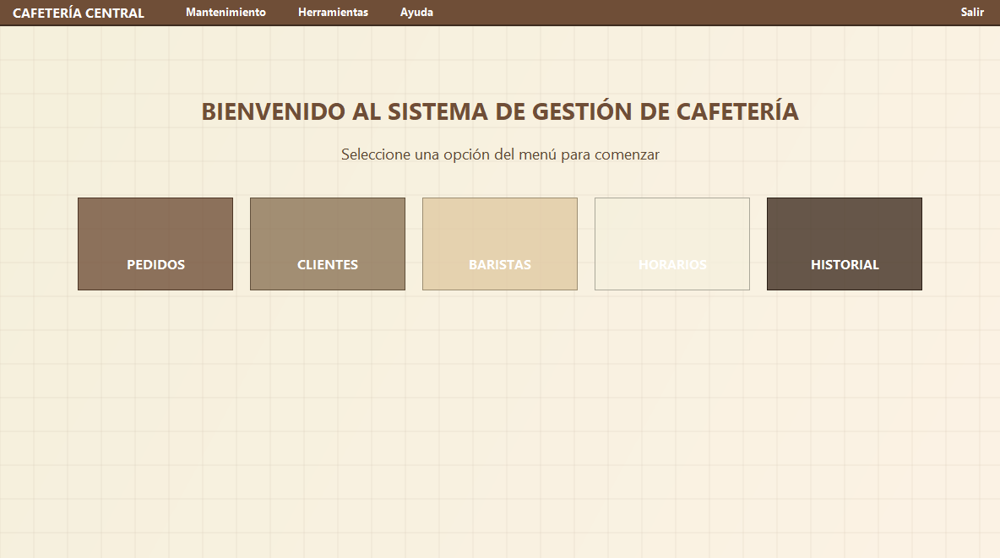
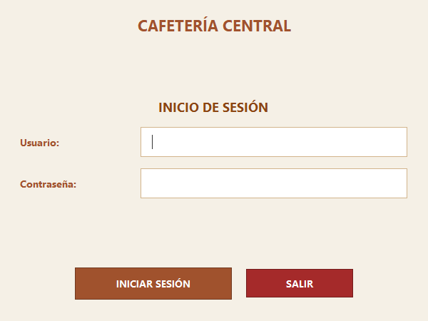
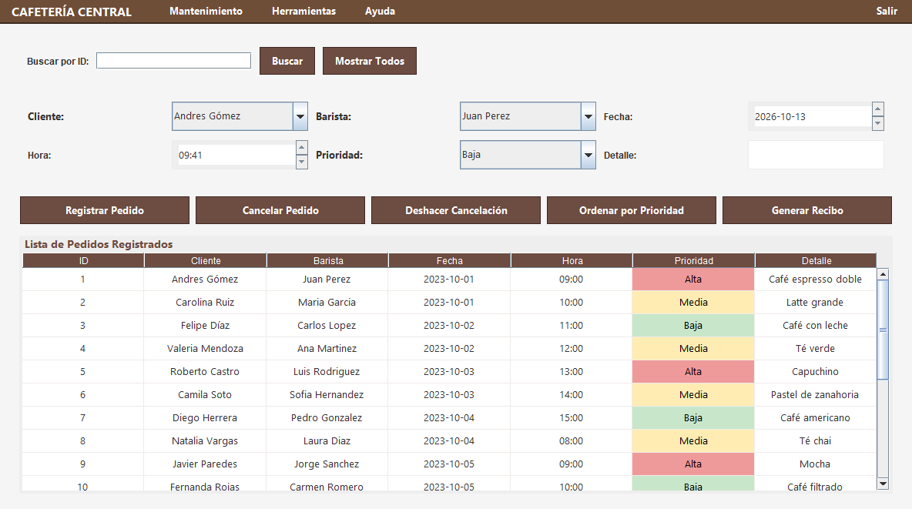
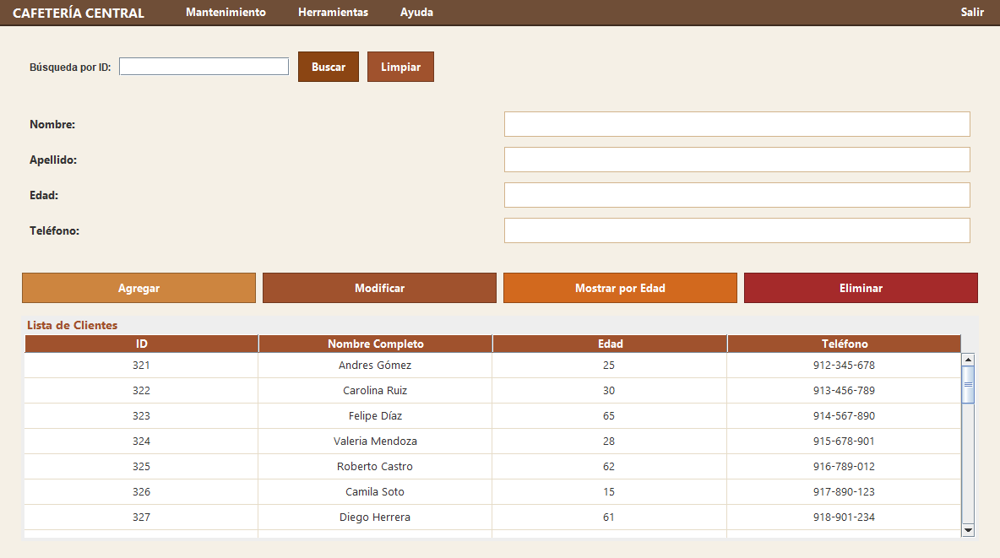
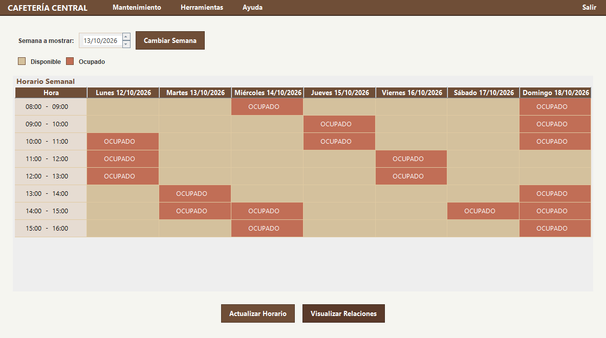
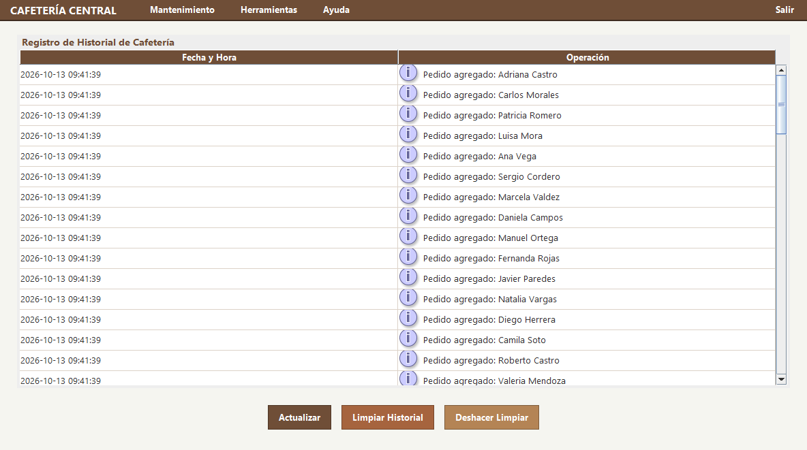

# Cafetería Central

Sistema de gestión para una cafetería que hicimos en el curso de **Estructura de Datos**. Es una aplicación de escritorio en Java (Swing) donde se registran pedidos, clientes y baristas, se ven los horarios ocupados de la semana y queda un historial de todo lo que se hace.

Lo interesante del proyecto, y el motivo por el que existe, es que casi todo funciona sobre estructuras de datos que implementamos nosotros desde cero (listas, pila, cola de prioridad, árbol y grafo), sin usar las colecciones de Java para la lógica principal.



## Cómo se ve

**Inicio de sesión.**



**Pedidos.** Registrar, cancelar, deshacer la cancelación, ordenar por prioridad y generar un recibo.



**Clientes.** Agregar, modificar, eliminar, buscar por ID y mostrar ordenados por edad.



**Horarios.** La semana con las franjas ocupadas según los pedidos, y un botón para ver las relaciones barista-cliente.



**Historial.** Cada operación queda registrada, y se puede limpiar y deshacer la limpieza.



## Estructuras de datos y para qué las usamos

| Estructura | Dónde | Para qué |
|---|---|---|
| Lista enlazada | `PedidoController` | Guardar todos los pedidos registrados |
| Cola de prioridad | `PedidoController` | Atender primero los pedidos de prioridad alta ("Ordenar por Prioridad") |
| Lista doble | `PedidosPanel` | Guardar los pedidos cancelados para poder deshacer la última cancelación |
| Pila | `HistorialController` | Historial de operaciones (lo último que pasó queda arriba) |
| Árbol binario | `ClientesPanel` | Buscar clientes por ID |
| Lista circular | `BaristasPanel` | Pasar al siguiente barista en rotación |
| Grafo | `HorariosPanel` | Mostrar qué barista atendió a qué cliente |
| Matriz `boolean[7][8]` | `HorarioController` | Marcar las franjas ocupadas de la semana (7 días x 8 horas) |

Clientes y baristas se guardan en arreglos que duplican su tamaño cuando se llenan. Cada estructura tiene su interfaz (`modelo/interfaces`) y su nodo (`modelo/nodos`).

## Tecnologías

- Java 17 con Swing para la interfaz
- Patrón MVC (`modelo`, `vista`, `controlador`)
- Proyecto de NetBeans (Ant, `build.xml`)

## Cómo correrlo

El código está dentro de `cafeteria.zip`. Descomprímelo y:

- **Con NetBeans:** abre la carpeta `cafeteria/cafeteria` como proyecto y dale a Run.
- **Desde la terminal** (con un JDK 17 o superior):

```bash
cd cafeteria/cafeteria
javac -encoding UTF-8 -d out $(find src -name "*.java")
java -cp out cafeteria.main.Main
```

Usuario y contraseña: `grupo04` / `grupo04`. Al arrancar se cargan datos de prueba (clientes, baristas y pedidos) para que puedas probar todo de una vez.
